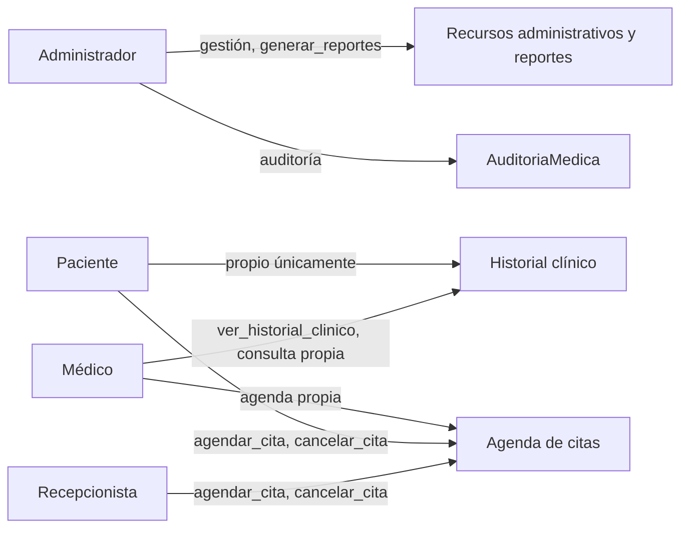

# Plataforma de Gestión de Consultas Médicas — UNCP

Prototipo académico con Django 5.2, SQLite, templates Django y Bootstrap 5. No está certificado ni debe utilizarse para atención clínica real; toda información de demostración es ficticia.

## Arquitectura

`config/` configura proyecto y seguridad; `usuarios/` contiene dashboards; `pacientes/`, `medicos/`, `citas/` y `auditoria/` separan dominios. Django Admin está personalizado. El modelo de usuario estándar de Django se asocia opcionalmente a médico/paciente; se crean los grupos Admins, Médicos, Recepcionistas y Pacientes. Mermaid de roles abajo.



## Instalación y ejecución

```bash
cd caso2
python3 -m venv .venv
. .venv/bin/activate
pip install -r requirements.txt
cp .env.example .env  # opcional; exportar variables antes de arrancar
python manage.py check
python manage.py makemigrations pacientes medicos citas auditoria
python manage.py migrate
python manage.py seed_demo
python manage.py runserver
```

Abrir http://127.0.0.1:8000. Acceso al admin en `/admin/`.

## Usuarios demo

- `admin_demo` / `DemoAdmin2026!`
- `medico1_demo` / `DemoMed2026!`
- `paciente1_demo` / `DemoPac2026!`
- Recepción: `recepcion_demo` / `DemoRecep2026!`

Cambiar claves antes de cualquier despliegue; el comando vuelve a establecer claves demo al ejecutarse.

## Capacidades actuales y seguridad

Incluye entidades paciente/médico/especialidad/horario/cita/consulta/notas, validación de DNI y CMP, correo institucional, fecha de nacimiento, agenda individual e institucional, duplicidad paciente/día y médico/hora, motivo mínimo, middleware de auditoría sin contenido clínico, alerta al médico, formularios de autenticación protegidos por CSRF, logout POST, cookies HttpOnly y expiración de sesión configurada en 20 minutos. El comando `seed_demo` instala permisos base en los grupos de demostración. Historial verifica acceso propio o permiso médico y auditoría registra resultado. La consulta clínica bloquea cambios posteriores; las notas tienen autor/fecha. En despliegue real se requiere revisar permisos clínicos y capacidad/identidad del médico.

En desarrollo HTTP se deja `COOKIE_SECURE=0`; en producción HTTPS usar `COOKIE_SECURE=1`, `DEBUG=0`, clave secreta robusta, hosts explícitos, TLS y configuración de proxy segura.

## Limitaciones

Este prototipo no es un sistema clínico certificado. SQLite no proporciona bloqueo de filas efectivo para resolver carreras simultáneas de agenda; en producción debe usarse una base de datos con bloqueos transaccionales y restricciones apropiadas. La agenda de disponibilidad expone citas futuras (no historias ni diagnósticos), y los permisos deben revisarse antes de uso real. El timeout de 20 minutos se renueva con actividad HTTP (`SESSION_SAVE_EVERY_REQUEST`).

## Pruebas

```bash
python manage.py test
```

Evidencias a tomar por el equipo en `capturas/`; lista en `CHECKLIST_EVIDENCIAS.md`.
